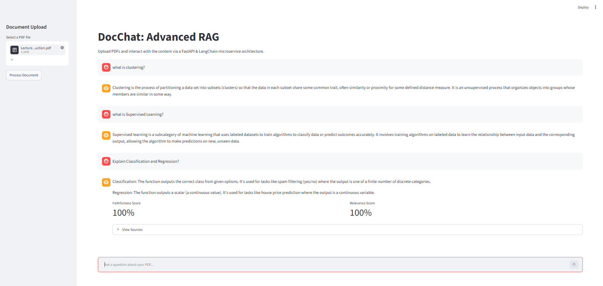

# 📚 DocChat: Enterprise-Grade RAG Microservice

 *(Note: Add a screenshot or GIF of your Streamlit app running here!)*

I built this application because I wanted to move beyond basic LangChain tutorials and build a Retrieval-Augmented Generation (RAG) architecture that actually resembles what I'd ship to production. 

DocChat isn't just a script that feeds a PDF to an LLM. It's a decoupled microservice architecture using **FastAPI** for the backend, **Streamlit** for the frontend, **Cohere** for advanced re-ranking, and a custom **LLM-as-a-Judge** evaluator to keep hallucinations in check. 

---

## The Architecture

1. **Frontend (Streamlit):** A clean, lightweight UI. It doesn't run any heavy ML models; it just talks to the backend via HTTP.
2. **Backend (FastAPI):** Handles the heavy lifting. Exposes `/upload` and `/ask` endpoints.
3. **Retrieval (ChromaDB + LangChain):** Uses HuggingFace's `all-MiniLM-L6-v2` to embed document chunks and store them in-memory.
4. **Re-ranking (Cohere):** Instead of trusting the top 3 semantic matches, the vector DB fetches 10 chunks, and Cohere re-ranks them based on true relevance.
5. **Generation (Groq Llama-3):** Generates the final answer using the ultra-fast Groq API.
6. **Quality Assurance (LLM-as-a-Judge):** Silently scores its own answers for Faithfulness and Relevance.

---

## Design Decisions & Tradeoffs

* **I chose Groq (Llama-3) instead of OpenAI:** OpenAI is great, but Groq's LPU inference speed is unbelievable. For an interactive chat app, the TTFT (Time To First Token) makes it feel magical. Plus, the free tier is extremely generous for personal projects.
* **I chose FastAPI + Streamlit instead of a Monolith:** While doing everything in Streamlit is faster to prototype, it doesn't scale. I wanted to prove I know how to build a real backend service that could theoretically support a React or mobile app in the future.
* **I chose ChromaDB in-memory instead of Pinecone:** I originally planned to use Pinecone (a cloud vector DB), but for a tool meant to quickly chat with a single uploaded document, wiping the database in RAM between sessions was actually a cleaner user experience than managing persistent cloud indexes.
* **I implemented Cohere Re-ranking:** Standard semantic search (BM25 or basic cosine similarity) often grabs chunks that use similar words but lack the actual answer. Fetching 10 chunks and letting Cohere's dedicated re-ranking model select the top 3 increased the answer quality drastically.

---

## The LLM-as-a-Judge Evaluator

One of the coolest parts of this project is the automated quality assurance. I didn't want to blindly trust the LLM, so I wrote a custom evaluator that forces a secondary LLM to grade the output before showing it to the user. 

Here is a snippet of the exact prompt I wrote for the Judge:

```python
evaluation_prompt = """
You are an impartial judge evaluating a RAG (Retrieval-Augmented Generation) system.
You will be given a User Question, the Retrieved Context from a document, and the System's Answer.

You must evaluate the system based on two metrics:
1. Faithfulness (0-100): Is the answer strictly derived from the provided context? Deduct points if the answer hallucinates information not present in the context.
2. Relevance (0-100): Does the answer directly address the user's question? Deduct points if it goes off on a tangent or fails to answer the question.

... You must return ONLY a raw JSON object with the two scores as integers.
"""
```
*This guarantees the UI can display confidence scores, ensuring transparency and trust in the system.*

---

## Lessons Learned / What I'd Do Differently

* **LangChain Versioning is wild:** I started building this during the transition to LangChain v1.0. I quickly learned that relying on legacy imports (`langchain.chains`) breaks easily. I had to learn the modern LangChain architecture (`langchain_classic`, `langchain_community`, `langchain_core`) to get the Cohere Contextual Compression working.

---

## How to Run Locally

1. Clone the repo and install dependencies:
   ```bash
   pip install -r requirements.txt
   ```
2. Create a `.env` file with your keys:
   ```env
   GROQ_API_KEY=your_key_here
   COHERE_API_KEY=your_key_here
   ```
3. Boot the FastAPI Backend:
   ```bash
   python -m uvicorn api:app --port 8000
   ```
4. Boot the Streamlit Frontend (in a new terminal):
   ```bash
   streamlit run app.py
   ```
